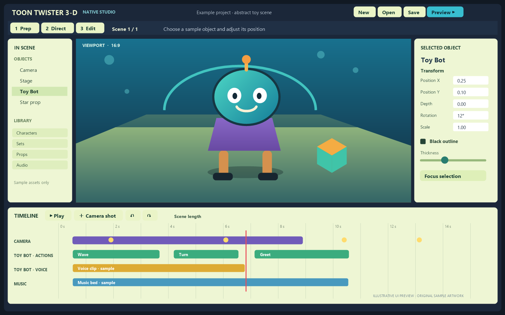
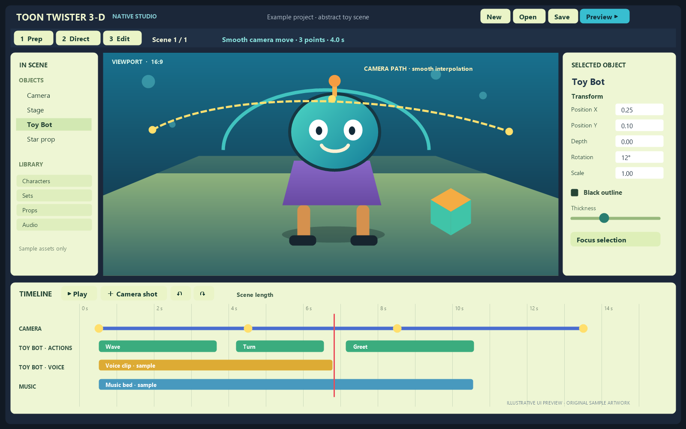

# Toon Twister 3-D Native Studio

Windows-native editor source for Toon Twister 3-D. It includes the editor code and an installer shell; original game media and converted game assets are kept local and are not part of this GitHub project.

## Preview

These illustrative UI previews show the editor layout and camera timeline using original sample artwork. They are mockups; no original game models, screenshots, or media are included.

## GitHub-safe contents

The `.gitignore` intentionally excludes `Assets/`, FFmpeg executables, build output, and personal `.ttnative` projects. Use Git or GitHub Desktop so those ignored files stay out of commits. Do not upload the folder by dragging all files into a web form.

## Local installation

Run `Toon Twister 3-D Setup.exe`, choose your own original Cartoon Twister 3-D installation, and choose a separate destination. The installer verifies the original folder, copies its media locally, then converts its W3D models/animations and supported Director audio during setup. Conversion can take several minutes. The original installation remains untouched.

The installer contains the editor program and asset-converter tools, but no original game files or preconverted game media. Converted models, animation caches, and audio are created on the user's PC from the folder selected in the installer. The converter is GPL-3.0-only; its license and corresponding source are in `Tools/AssetConverter`.

## Languages

The setup includes Dutch and English UI. It saves the selected language beside the installed editor executable, and the editor applies it to its controls, menus, timeline, and in-app dialogs on startup.

## Build notes

- Windows 11, .NET 10 Desktop Runtime for the installer, and .NET 8 Windows Desktop runtime for source builds.
- The bundled editor apphost is built for `win-x64`.
- To rebuild the native editor payload, run `dotnet publish ToonTwisterNative.csproj -c Release -r win-x64 --self-contained true -p:PublishSingleFile=true -p:IncludeNativeLibrariesForSelfExtract=true -p:EnableCompressionInSingleFile=true -p:LeanInstallerBuild=true -o InstallerPayload`.
- Then publish `Installer/ToonTwisterSetup.csproj` with `--self-contained false -p:PublishSingleFile=true -o InstallerSetupPublish` and copy `InstallerSetupPublish/ToonTwisterSetup.exe` to this folder as `Toon Twister 3-D Setup.exe`.
- The setup app is framework-dependent to keep its executable below GitHub's per-file size limit; users need the .NET 10 Desktop Runtime.
- The installer embeds the two converter executables from `Tools/AssetConverter` and runs them against the user-selected source folder. Rebuild instructions and the matching GPL source are included there.

## Original game content

Every user must provide a legally obtained original installation. The installer copies game files locally from that selected folder; this repository and the installer executable do not distribute the original EXE, models, textures, audio, videos, or game data.
